<h1 align="center">Conditional generation of Kuzushiji characters</h1>

<p align="center">
  <b>A conditional VAE and a conditional GAN asked to draw one of 49 classical Japanese characters, in a thin or a thick hand.</b><br>
  Both models were written in PyTorch and trained on Kuzushiji-49 (270,912 images of 28 × 28 pixels), conditioned on the character class and on a thin/thick style label derived from each image's foreground pixel count. Three CVAE and two CGAN variants followed.
</p>

<p align="center">
  
  
  <a href="PGM_Report.pdf"></a>
  
</p>

<p align="center">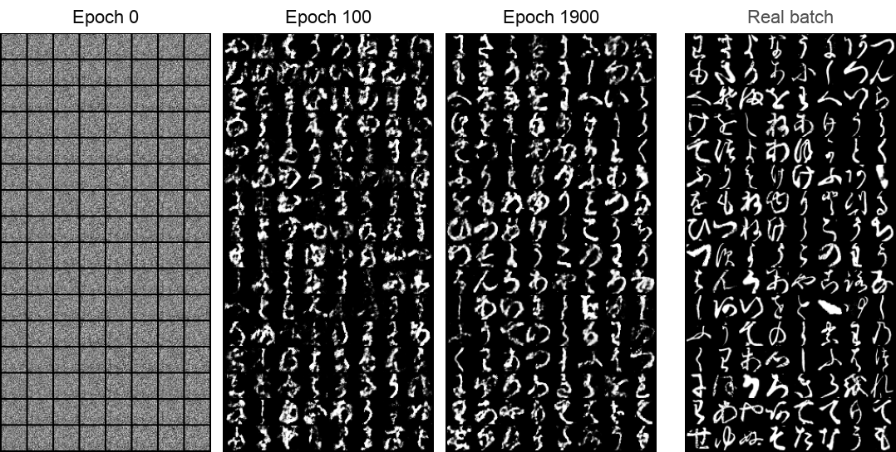</p>
<p align="center"><sub><i>CGAN training-loop output at epochs 0, 100 and 1900, beside the real batch whose labels the epoch-1900 grid was generated for. Cropped from report Figures 12–14, axes removed.</i></sub></p>

<p align="center">
  <a href="#at-a-glance">At a glance</a> ·
  <a href="#results">Results</a> ·
  <a href="#method">Method</a> ·
  <a href="#data">Data</a> ·
  <a href="#reproduce">Reproduce</a> ·
  <a href="#notes-and-limitations">Notes</a>
</p>

---

## At a glance

| Task | Question | Method | Headline result |
|---|---|---|---|
| Style labels | Label stroke weight without annotations | Foreground pixel count per image, split at the class median | A thin/thick label for every image (class 0 median: 312 pixels) |
| CVAE | Draw a requested class in a requested style | Conditional VAE, 2-D latent space, one 144-unit hidden layer, 2000 epochs | Right shape and a visible thin/thick difference, but blurry; training loss fluctuates around 220–230 |
| CGAN | The same task with adversarial training | Conditional GAN, 64-D noise, 256-unit generator and discriminator, 2000 epochs | Training-loop images close to real characters by epoch 1900; stand-alone samples fragmented |
| Variants | Do the label rule, input order, depth or output activation matter? | Three CVAE and two CGAN variants, short runs | No clear CVAE gain; a CGAN with sigmoid output on [0, 1] data gave the most realistic images |

## Results

### Conditional samples

The grids at the top of the page show the main CGAN at its best. By epoch 1900 the generated batch follows the real batch cell by cell (へ, と, を and く sit in the same cells), so the class labels were steering the generator. The report calls these images very similar to the real ones, with above average image quality.

<p align="center">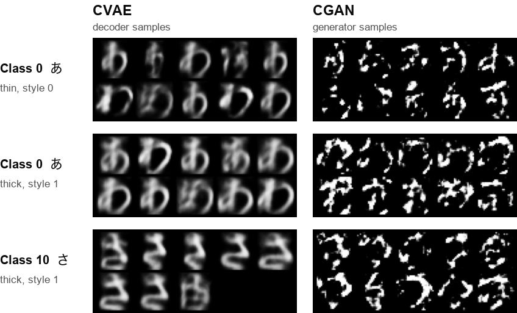</p>
<p align="center"><sub><i>Samples generated from class and style labels alone after training: CVAE decoder (report Figures 9–11) and CGAN generator (Figures 15–17). Cropped from the report, axes removed.</i></sub></p>

The CVAE keeps the overall shape of the requested character and its thin and thick samples differ, but every sample is blurry, which the report puts down to squeezing a 784-pixel image through a two-dimensional latent space. Samples from the trained CGAN generator are, in the report's words, fragmented and indistinct, although the same generator produced the training-loop grids above ([Notes and limitations](#notes-and-limitations) gives a likely reason). The report rates the CVAE samples higher for quality and resemblance to real characters (Figures 9 and 15) and the CGAN's as less blurry (Figures 10 and 16).

### CGAN variants

<p align="center">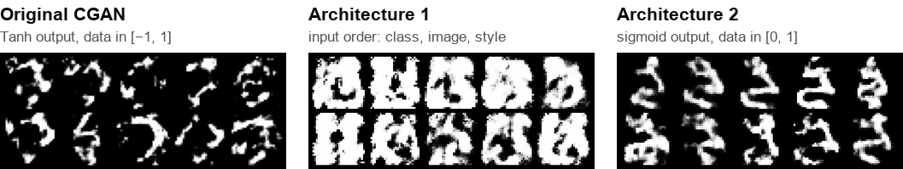</p>
<p align="center"><sub><i>Class 10 (さ), thick: the original CGAN (report Figure 17), architecture 1 (Figure 32b) and architecture 2 (Figure 36). Cropped from the report; the two larger grids were downscaled to match.</i></sub></p>

Architecture 2 swapped the generator's Tanh output for a sigmoid and kept the data in [0, 1]. It is the only CGAN set-up whose samples are whole characters, and after 100 epochs the report already rates it above the original CGAN trained for 2000 epochs. Architecture 1 only moved the image between the class and style vectors; its samples are more complete than the original's but miss fine detail. The report's conclusions favour the CGAN overall: images with higher resemblance to real data, less blur than the CVAE and the most realistic results from architecture 2.

### Training losses

<p align="center">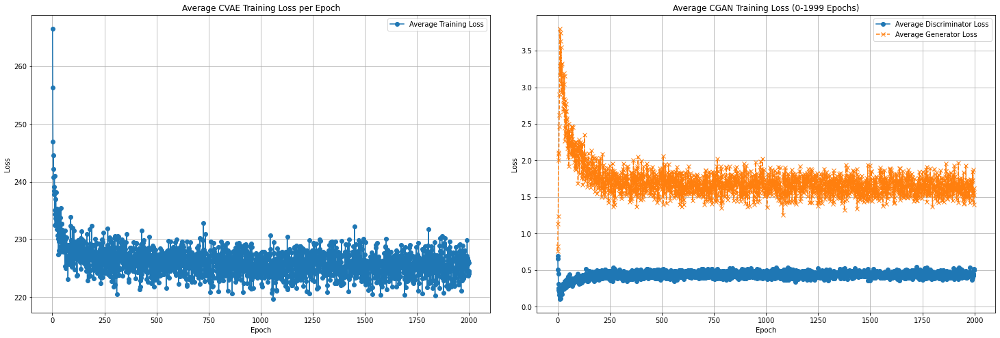</p>
<p align="center"><sub><i>Average loss per epoch over 2000 epochs: CVAE training loss (left, report Figure 19) and CGAN discriminator and generator losses (right, Figure 20). Extracted from the report.</i></sub></p>

The CVAE loss starts around 270 in the first epoch, falls quickly and then fluctuates around 220–230 for the rest of training. The CGAN generator loss peaks above 3.5 early on while the discriminator starts around 0.5; after that the discriminator stays around 0.4 to 0.5 and the generator fluctuates between 1.0 and 2.0, which the report reads as a sign that more tuning was needed.

<details>
<summary><b>Experiments: three CVAE and two CGAN variants</b></summary>

<br>

The report gives 100 epochs for each variant, against 2000 for the main models.

| Variant | Change from the main model | Training time | Outcome in the report |
|---|---|---|---|
| CVAE architecture 1 | Style split at the class mean instead of the median | 688.14 s | Average training loss 228, validation loss 230, MSE 0.06; no significant improvement |
| CVAE architecture 2 | Image, class and style inputs concatenated in a different order | 681 s | Not much improvement |
| CVAE architecture 3 | Two extra encoder layers (to 256, then 128) mirrored in the decoder, each with batch normalisation and ReLU | 1303 s | Output similar to the other two |
| CGAN architecture 1 | Image placed between the class and style vectors | not reported | More complete images than the original, missing fine detail; needs more epochs |
| CGAN architecture 2 | Sigmoid output, data kept in [0, 1]; learning rate 0.001 | not reported | Whole characters after 100 epochs |

<p align="center">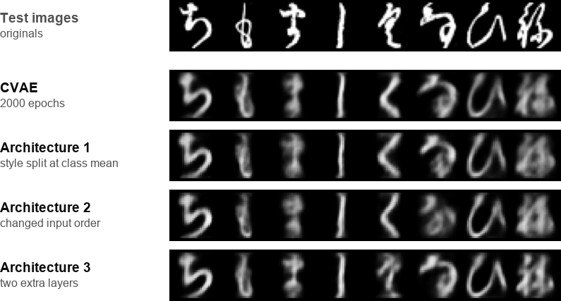</p>
<p align="center"><sub><i>The same eight test images reconstructed by the main CVAE (report Figure 8) and architectures 1–3 (Figures 22, 25 and 28). Cropped from the report; the larger strips were downscaled to a common width.</i></sub></p>

<p align="center">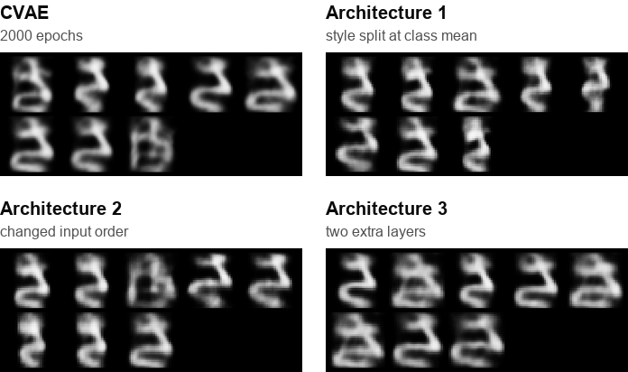</p>
<p align="center"><sub><i>Class 10, thick samples from the main CVAE (report PDF p. 32) and architectures 1–3 (pp. 43, 45 and 46). Cropped from the report; the larger grids were downscaled to match.</i></sub></p>

<p align="center">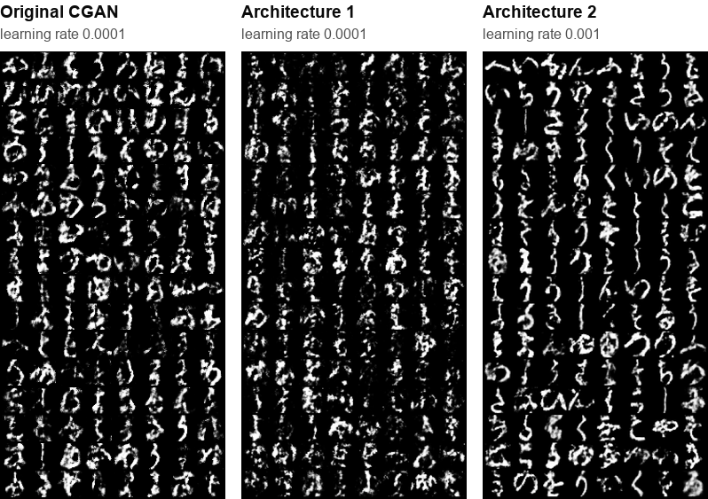</p>
<p align="center"><sub><i>Training-loop output at epoch 100 for the three CGAN set-ups, with learning rates as printed in each figure. Cropped from report Figures 13, 33b and 35; the two larger panels were downscaled to match.</i></sub></p>

<p align="center">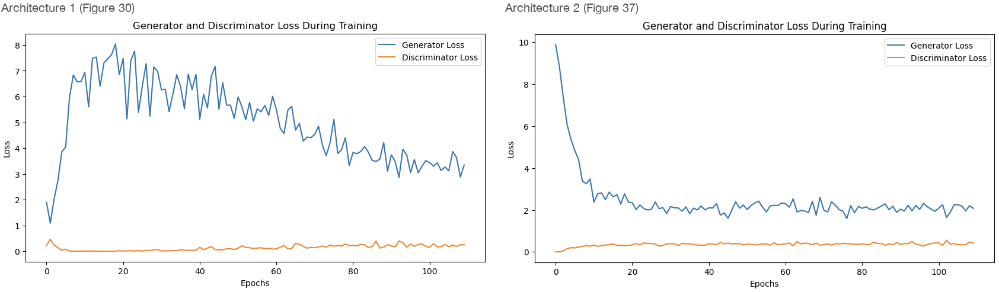</p>
<p align="center"><sub><i>Generator and discriminator losses of CGAN architectures 1 and 2 (report Figures 30 and 37). Extracted from the report.</i></sub></p>

Architecture 1's generator loss peaks around epoch 20 and then drifts down; architecture 2's falls sharply from around 10. Both discriminator losses stay low.

</details>

## Method

### Style labels and preprocessing

Kuzushiji-49 has no stroke-weight annotation, so the project made one. For each image it counted the foreground pixels and labelled the image thick (style 1) if the count was above its class median and thin (style 0) if below.

<p align="center">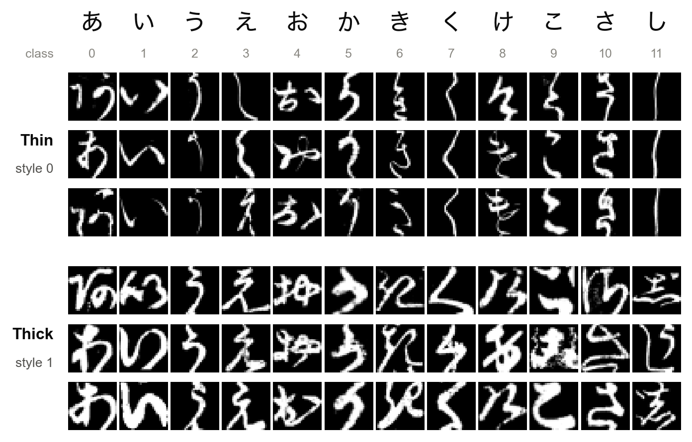</p>
<p align="center"><sub><i>Re-run of the report's style labelling on the public Kuzushiji-49 arrays (images by CODH, CC BY-SA 4.0). Three random examples per style and class, from the lowest and highest quarter of each class's pixel counts.</i></sub></p>

Because the label measures ink, a class's thick half mixes heavier strokes with busier variant forms (classes 6 and 11 above).

Preprocessing followed Section 3 of the report:

1. Merge the Kuzushiji-49 train and test `.npz` files.
2. Scale the pixels to [0, 1] (`float32`, divided by 255).
3. Add the style labels.
4. One-hot encode the class (49) and the style (2) and concatenate them with the flattened image (784): 835 features.
5. Split 70/30 with `train_test_split`: 189,638 training and 81,274 test rows.

The CVAE trained on the training split. The CGAN trained on the whole merged array, rescaled to [−1, 1] with `x * 2 - 1` to match the generator's Tanh output.

### CVAE

The CVAE has one 144-unit hidden layer on each side of a two-dimensional latent space, and both halves see the one-hot labels:

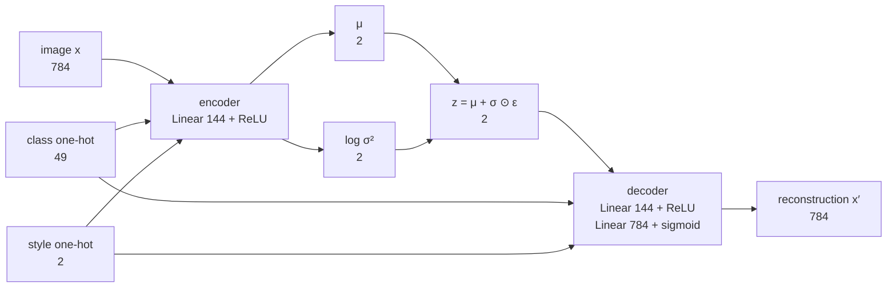

Training used Adam with a learning rate of 0.001, batches of 100 and 2000 epochs. To generate, the decoder takes z drawn from N(0, I) with the chosen class and style.

The report's objective (Section 2.2) is the conditional evidence lower bound, with y the class and style vectors:

```math
\mathrm{ELBO} = \mathbb{E}_{q_\phi(z \mid x, y)}\left[\log p_\theta(x \mid z, y)\right] - \mathrm{KL}\left(q_\phi(z \mid x, y) \parallel p_\theta(z \mid y)\right)
```

The code minimises the negative ELBO with a standard normal prior: binary cross-entropy plus the closed-form KL term, both summed over the batch.

```math
\mathcal{L} = \mathrm{BCE}_{\mathrm{sum}}(x', x) - \frac{1}{2} \sum_{j=1}^{2} \left(1 + \log \sigma_j^2 - \mu_j^2 - \sigma_j^2\right)
```

### CGAN

Generator and discriminator each have one 256-unit hidden layer and see the one-hot labels; the generator's Tanh output lies in [−1, 1]:

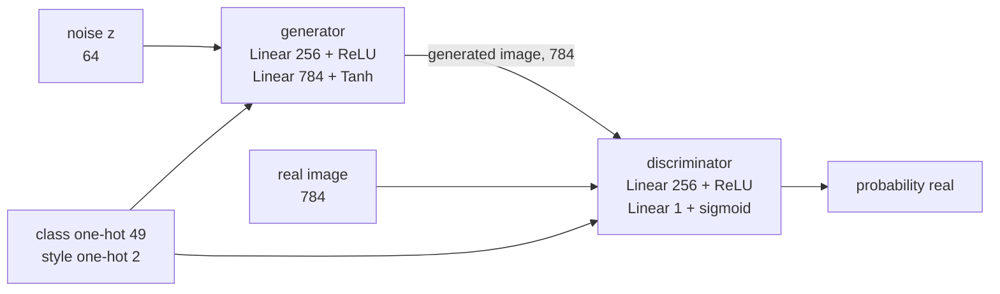

Both networks used Adam with a learning rate of 0.0001, batches of 128 and `nn.BCELoss`, for 2000 epochs. The discriminator loss is the mean of its real and fake terms; the generator is trained to make the discriminator call its images real, maximising log D(G(z)). Every 100 epochs the first batch was saved as a real and generated grid (the figure at the top of the page).

The conditional minimax game from the report (Equation 4):

```math
\min_G \max_D V(D, G) = \mathbb{E}_{x \sim p_{\mathrm{data}}(x)}\left[\log D(x \mid y)\right] + \mathbb{E}_{z \sim p_z(z)}\left[\log\left(1 - D(G(z \mid y))\right)\right]
```

### Evaluation

Evaluation was visual: reconstructions of the first test batch, sample grids for classes 0 and 10, the training-loop grids and the loss curves. The one reconstruction error reported is an MSE of 0.06 for CVAE architecture 1.

## Data

[Kuzushiji-49](https://github.com/rois-codh/kmnist) from the ROIS-DS Center for Open Data in the Humanities (CODH): 270,912 greyscale 28 × 28 images of cursive hiragana in 49 classes, published as 232,365 training and 38,547 test images. The project loaded the four `.npz` files (`k49-train-imgs.npz`, `k49-train-labels.npz`, `k49-test-imgs.npz`, `k49-test-labels.npz`) and merged the two parts. The kana labels on this page come from the dataset's `k49_classmap.csv`. The data are not stored in this repository.

Licence: [CC BY-SA 4.0](https://creativecommons.org/licenses/by-sa/4.0/). "KMNIST Dataset" (created by CODH), adapted from "Kuzushiji Dataset" (created by NIJL and others), doi:10.20676/00000341. Paper: T. Clanuwat, M. Bober-Irizar, A. Kitamoto, A. Lamb, K. Yamamoto and D. Ha (2018), [Deep Learning for Classical Japanese Literature](https://arxiv.org/abs/1812.01718). The Kuzushiji-49 images in the figures on this page are shown under that licence.

## Repository contents

| Path | What it is |
|---|---|
| [`PGM_Report.pdf`](PGM_Report.pdf) | The report (56 pages): literature review, data preparation (Section 3), code listings (4), results (5), experiments (6) and conclusions (7) |
| `README.md` | This page |
| `docs/images/` | Figures for this page: crops of the report's own figures and one re-run on the public data |

Not in the repository: the source code, which was accidentally deleted (Section 4 of the report prints the model and training code), the Kuzushiji-49 data, and the trained weights (`cvaeModel.pth`, `generatorModel.pth` and `discriminatorModel.pth`).

## Reproduce

There is no runnable code here. A rebuild starts from the listings in Section 4 of the report (PDF pages 18–29) and needs:

1. Python with PyTorch, torchvision, NumPy, Matplotlib and scikit-learn (imported on PDF pages 18–19; versions not recorded). The listings use a CUDA GPU when one is available.
2. The four Kuzushiji-49 `.npz` files from [rois-codh/kmnist](https://github.com/rois-codh/kmnist).
3. The preprocessing from Section 3, including the helpers `countForegroundPixels` and `to_one_hot`, which are described there but not listed. Counting pixels above 0 reproduces the class medians printed in Figure 5.
4. The CVAE listing (PDF pages 19–24) and the CGAN listing (pages 24–29), each run for 2000 epochs, with the save paths pointed at a local folder.

The 70/30 split has no recorded seed, so expect results to differ in detail from the report; before sampling from the CGAN, see the label-scaling note under [Notes and limitations](#notes-and-limitations).

## Context

Coursework for *Probabilistic Graphical Models*, Western Sydney University, 2024.

## Notes and limitations

- Comparisons are visual only, with no sample-quality metric; thin/thick control is judged by eye.
- The style label is a pixel-count proxy for stroke weight, so character size and variant forms feed into it too.
- The CGAN's stand-alone samples (Figures 15–17) are much weaker than its training-loop grids. The listings suggest a likely cause (untested): `x * 2 - 1` also rescales the one-hot label columns, so training saw −1/1 labels while sampling used 0/1.
- The report's own challenges were training time and compute (especially for the CGAN), image clarity and a fluctuating generator loss; its next steps are better CVAE latent representations, Wasserstein GANs or other loss functions, and larger, more varied datasets.
